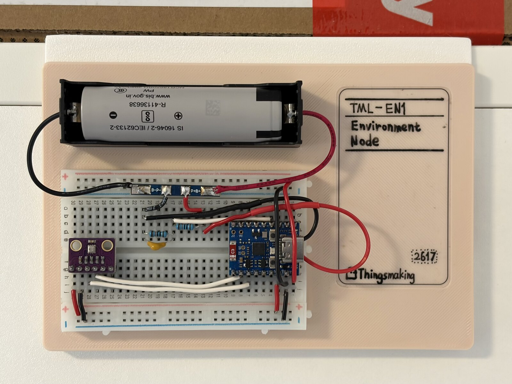
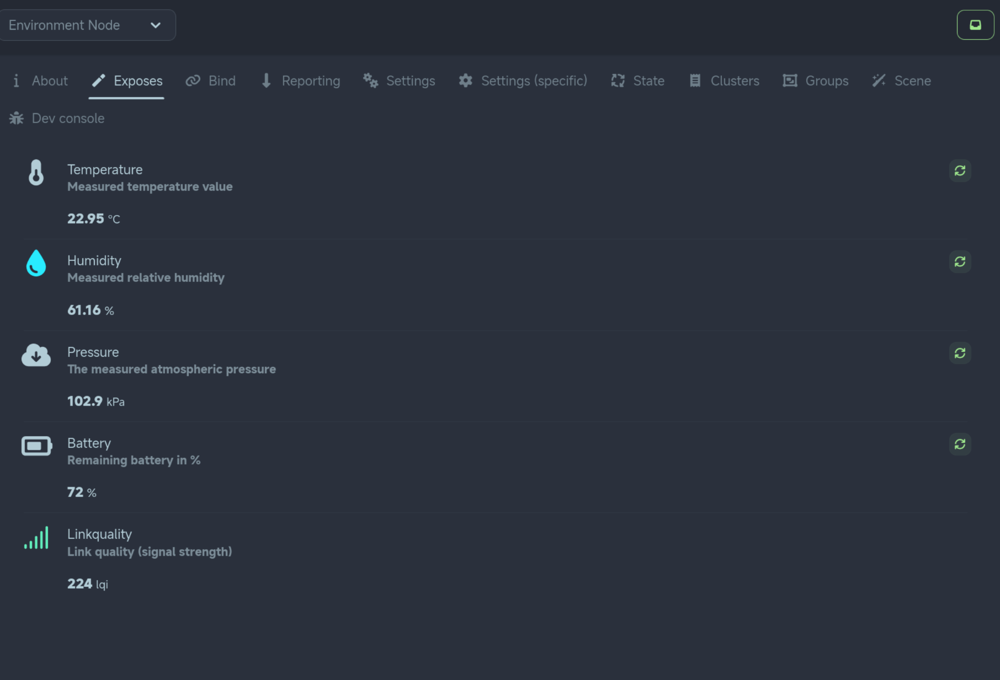
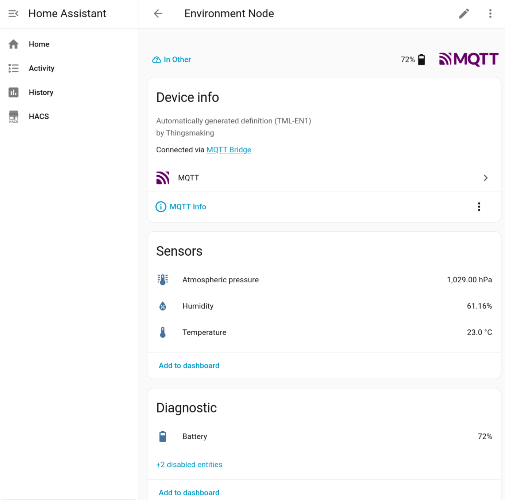
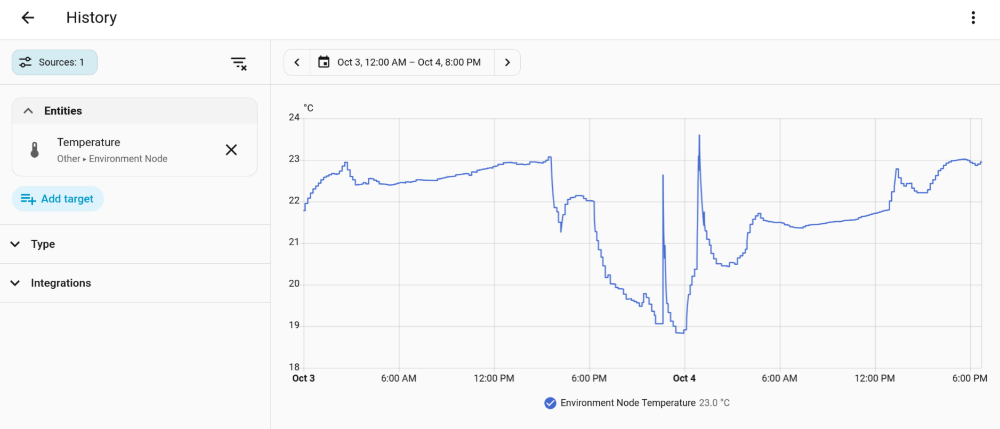

# Environment Node (TML-EN1)

[English](readme.md) | **中文**


[快速开始](#快速开始) · [硬件](#硬件) · [Zigbee 接口](#zigbee-接口) · [已知限制](#已知限制)


> TML-EN1 是一个自制的 Zigbee 智能家居环境传感器节点，可以采集温度、湿度、气压等环境数据，通过 Zigbee 上报给 Zigbee2MQTT / Home Assistant，辅助实现自动化家居控制。设备为低功耗场景优化，无须频繁更换电池。





## 注意

这是一个实验性项目，仍存在很多问题。且你可能需要亲自修改代码/硬件才能使它正常工作。


## 简介

TML-EN1 (Thingsmaking Link - Environment Node 1) 基于 ESP32-H2, 能通过 Zigbee 协议上报其上多种不同环境传感器的测量数据，辅助实现家居自动化。设备为全天候低功耗运行优化，无须频繁维护 / 更换电池。

设备所有数据仅使用标准 Zigbee 簇（ZCL），任何兼容的 Zigbee 协调器（Home Assistant ZHA、Zigbee2MQTT 等）都能直接接收，无需自定义协议或专用网关。


## 演示



*Zigbee2MQTT 中的设备页面：温度、湿度、气压、电量与链路质量的实时值。*



*Home Assistant 中的设备页面：设备定义由协调器自动生成，厂商与型号均被正确识别。*



*Home Assistant 历史记录：连续 44 小时（10 月 3 日至 4 日）无断档的温度曲线。*


## 硬件

### 物料清单

| 类别 | 型号 / 规格 | 数量 | 备注 |
|---|---|---|---|
| 主控 | ESP32-H2 Supermini | 1 | 带有锂电池充电管理模块的 ESP32-H2 Supermini 开发板 |
| 传感器 | BME280 | 1 | I2C 接口，默认地址 `0x76` |
| 电池 | 18650 锂离子电池 | 1 | 及配套电池盒和 1S 锂电池保护板 |
| 电源采样 | 分压电阻 | 2 | 10kΩ |
| 电源采样 | ADC 输入滤波电容 | 1 | 100nF 陶瓷电容 |
| 结构件 | 〔待补充〕         |      |                                                    |


### 引脚与接线

| 功能 | 引脚 | 参数 |
|---|---|---|
| I2C SDA | GPIO10 | 主机模式，内部上拉使能 |
| I2C SCL | GPIO11 | 100 kHz |
| 电池电压采样 | GPIO1 | ADC1 通道 0，12 dB 衰减，curve-fitting 校准 |


### 供电与功耗

设备由单节 18650 锂离子电池供电。电池电压经电阻分压后接入 ADC。电量百分比由一段分段线性放电曲线插值计算。

功耗方面固件启用了以下机制：

| 机制 | 配置 |
|---|---|
| 动态调频 | 最高 96 MHz，最低 32 MHz |
| 自动 light sleep | 使能 |
| FreeRTOS tickless idle | 使能 |
| 802.15.4 射频休眠 | 使能 |
| 休眠时关闭 Flash 供电 | 使能 |

Zigbee 侧关闭了空闲接收（`rx_on_when_idle = false`），节点仅在需要收发时唤醒射频。


## Zigbee 接口

### 设备身份

| 项 | 值 |
|---|---|
| 厂商名（Manufacturer Name） | `Thingsmaking` |
| 型号标识（Model Identifier） | `TML-EN1` |
| 端点 | 1 |
| 应用配置 ID | Home Automation（`0x0104`） |
| 设备类型 | Temperature Sensor（`0x0302`） |
| 电源类型 | 电池（Basic 簇 `PowerSource`） |

> 说明：ZCL 字符串属性带长度前缀，因此代码中写作 `"\x0C""Thingsmaking"` 与 `"\x07""TML-EN1"`，`\x0C` 与 `\x07` 分别是两个字符串的字节长度。


### 端点与簇

端点 1 上实现以下服务端簇：

| 簇 | 簇 ID | 属性 | 数据类型 | 单位 / 分辨率 | 取值范围 |
|---|---|---|---|---|---|
| Basic | `0x0000` | ManufacturerName / ModelIdentifier / PowerSource | 字符串 / 枚举 | — | — |
| Power Configuration | `0x0001` | BatteryPercentageRemaining | `U8` | 0.5 % | 0–200 |
| Temperature Measurement | `0x0402` | MeasuredValue | `S16` | 0.01 °C | −1000–5000（−10–50 °C） |
| Pressure Measurement | `0x0403` | MeasuredValue | `S16` | 0.1 kPa | 300–1100（30–110 kPa） |
| Relative Humidity Measurement | `0x0405` | MeasuredValue | `U16` | 0.01 % | 0–10000（0–100 %） |

节点入网后会向协调器（短地址 `0x0000`）逐一建立上述四个测量簇的绑定（Bind），随后按上报配置周期发送属性上报。


### 上报策略

四个测量量共用同一套上报参数：

| 属性 | 最短间隔 | 最长间隔 | 触发变化量 |
|---|---|---|---|
| 温度 | 60 s | 600 s | 20（0.2 °C） |
| 湿度 | 60 s | 600 s | 300（3 %RH） |
| 气压 | 60 s | 600 s | 1（0.1 kPa） |
| 电量 | 60 s | 600 s | 4（2 %） |

采样节拍为 60 秒：Zigbee 协议栈的定时器每 60 秒触发一次采集任务，任务完成后自行退出。最长间隔保证即使环境恒定，数据也会在 10 分钟内刷新一次。


### 网络行为

| 项 | 配置 |
|---|---|
| 设备角色 | 终端设备（ZED） |
| 首选信道 | 11 |
| 终端老化超时 | 64 分钟 |
| Keep-alive | 60 秒 |
| 入网策略 | 出厂新设备自动发起 Network Steering；入网失败每 1 秒重试；已入网设备重启后直接恢复上报配置 |


## 快速开始

### 环境要求

| 项 | 版本 |
|---|---|
| ESP-IDF | 6.0.0 |
| 目标芯片 | esp32h2 |
| Flash 大小 | 2 MB |
| 依赖组件 | `espressif/bme280`、`espressif/esp-zigbee-lib ~1.6.0`、`espressif/esp-zboss-lib ~1.6.0` |

`sdkconfig.defaults` 为配置基准，依赖在编译时由组件管理器自动下载。


### 编译与烧录

```bash
# 在 ESP-IDF 环境中
idf.py set-target esp32h2
idf.py build
idf.py -p <串口设备> flash monitor
```


### 分区表

分区表为自定义（`partitions.csv`）：

| 名称 | 类型 | 偏移 | 大小 | 用途 |
|---|---|---|---|---|
| `nvs` | data / nvs | `0x9000` | 24 KB | 非易失存储 |
| `phy_init` | data / phy | `0xf000` | 4 KB | 射频校准数据 |
| `factory` | app / factory | `0x10000` | 900 KB | 应用程序 |
| `zb_storage` | data / fat | `0xf1000` | 16 KB | Zigbee 协议栈存储（网络参数等） |
| `zb_fct` | data / fat | `0xf5000` | 1 KB | Zigbee 协议栈工厂数据 |

`zb_storage` 与 `zb_fct` 由 Zigbee 协议栈占用，不可删除或缩小，否则协议栈无法正常启动。本设备暂不支持 OTA 空中升级。


## 使用说明

### 首次入网

1. 在协调器端开放入网（Home Assistant ZHA 为「添加设备」，Zigbee2MQTT 为 `Permit join`）。
2. 节点上电，串口日志出现 `System starting...`，随后是各外设的初始化信息。
3. 节点未入网时会自动发起 Network Steering，日志出现 `Joined network successfully.` 即入网成功，随后输出 `Automatic reporting configured.` 与 `Binding configured.`。


### 日常运行

节点每 60 秒输出一行读数日志，格式如下：

```
Readings: Temp: 22.31 C, Humidity: 45.60 %, Pressure: 101.32 kPa, Bat: 87 %
```

若日志停止更新，说明采样任务未被执行：先确认节点入网状态（日志中是否出现 `Joined network successfully.`），再检查上电时的外设初始化是否全部成功。


### 更换电池

断电后更换电池并重新上电即可。网络参数保存在 `zb_storage` 分区，正常重启后无需重新入网，节点会直接恢复上报。


## 已知限制

- **暂不支持 OTA 升级。**
- **未提供自定义设备定义（quirk / external converter）。** 协调器可自动生成可用的设备定义并正常上报，但实体命名、图标与单位沿用自动生成的结果，无法定制。
- **电量百分比为近似值。**
- **传感器读取失败无降级处理。** 采样路径上的 `ESP_ERROR_CHECK` 在传感器无响应时会触发断言并重启，节点无法在传感器故障时继续上报电量。
- **没有按键恢复出厂设置 / 重新绑定的功能。**恢复出厂设置 / 重新配置入网只能手动使用 `idf.py` 擦除 flash。


## 相关项目与致谢

- 传感器驱动使用 Espressif 官方组件 [`espressif/bme280`](https://components.espressif.com/components/espressif/bme280)，本仓库中的初始化流程在其基础上改为 Forced Mode。
- Zigbee 协议栈使用 `esp-zigbee-lib` 与 `esp-zboss-lib`。


## 许可证

本项目采用 MIT 许可证，全文见 [LICENSE](LICENSE)。

你可以自由使用、修改和分发本仓库中的代码，只需保留原始版权声明与许可证文本。
